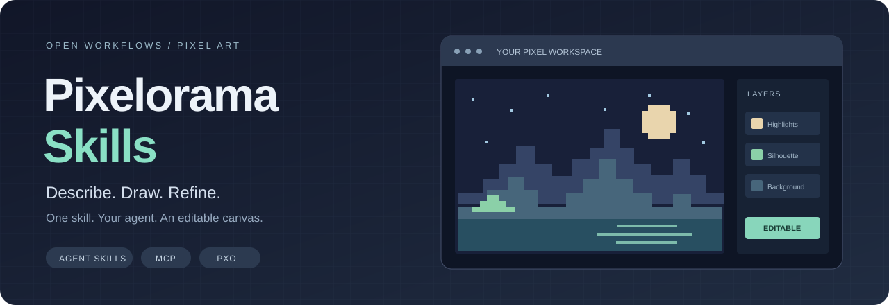

<div align="center">



# Pixelorama Skills

**一份通用 Skill，让像素画从描述走向可编辑的工程。**

[](https://agentskills.io)
[](https://github.com/abidoo22/Pixelorama-MCP)
[](LICENSE)

[English](README.md) · [简体中文](README.zh-CN.md) · [查看 Skill](skills/pixelorama-skills/SKILL.md) · [安装与连接](skills/pixelorama-skills/references/setup.md)

</div>

为 **Codex、Claude Code，以及支持 Agent Skills + MCP 的其他代理**提供一套完整的像素画工作流程：检查环境、连接 Pixelorama、批量绘制、查看成品、局部精修，最后交付可继续编辑的工程。

Pixelorama 提供编辑器，[Pixelorama-MCP](https://github.com/abidoo22/Pixelorama-MCP) 提供操作工具，**这个仓库负责教会 AI 怎样把它们用好。** 不另造编辑器，不捆绑图像模型，不偷偷启动后台服务。

> 独立社区项目，与 Orama Interactive、Pixelorama-MCP 维护者、OpenAI、Anthropic 均无官方关联或背书。Skill 是操作规范，不会凭空增加工具权限，也不保证美术质量。

## 可以帮助完成什么

| 创作 | 精修 | 交付 |
| --- | --- | --- |
| 像素角色、图标、道具、界面元素 | 轮廓、配色、边缘、小尺寸辨识度 | 可编辑 `.pxo` + 透明 PNG |
| 待机循环、短角色动画 | 锚点、造型一致性、帧顺序与节奏 | 精灵图、PNG 序列及受支持的动画格式 |
| 瓦片地图、循环场景 | 接缝、地形过渡、风格统一 | 瓦片图；按需导出受支持的 Godot 资源 |

具体能力取决于已连接的桥接服务与模型。导入一张图片，不等于自动获得语义图层或一致的动画。

## 上游效果展示

以下作品来自 **Pixelorama-MCP 上游仓库**，使用固定版本的外链并保留署名。它们展示底层工具链的可能性，**不是本 Skill 已复现或验收的作品**，图片仍托管在上游。

<table>
<tr>
<td width="50%" align="center"><a href="https://github.com/abidoo22/Pixelorama-MCP/tree/56fd8aa94c0905591bd2515fe9823eb70d4496d2"></a><br><b>Animated worlds</b><br><sub>Upstream Pixelorama-MCP example</sub></td>
<td width="50%" align="center"><a href="https://github.com/abidoo22/Pixelorama-MCP/tree/56fd8aa94c0905591bd2515fe9823eb70d4496d2"></a><br><b>Looping scenes</b><br><sub>Upstream Pixelorama-MCP example</sub></td>
</tr><tr>
<td width="50%" align="center"><a href="https://github.com/abidoo22/Pixelorama-MCP/tree/56fd8aa94c0905591bd2515fe9823eb70d4496d2"></a><br><b>Tiles and game assets</b><br><sub>Upstream Pixelorama-MCP example</sub></td>
<td width="50%" align="center"><a href="https://github.com/abidoo22/Pixelorama-MCP/tree/56fd8aa94c0905591bd2515fe9823eb70d4496d2"></a><br><b>Pixel interfaces</b><br><sub>Upstream Pixelorama-MCP example</sub></td>
</tr>
</table>

作品来源：**pix-MCP Contributors / 上游项目**。详见[来源与许可](THIRD_PARTY_NOTICES.md)。顶部封面是仓库装饰图，不是使用本 Skill 绘制的样片。

## 开始使用

只需将完整的 `skills/pixelorama-skills/` 文件夹复制到对应目录。`SKILL.md`、`references/`、可选的诊断脚本和 `LICENSE` 应一起保留。

| 客户端 | 个人安装 | 项目内安装 |
| --- | --- | --- |
| Codex | `~/.agents/skills/pixelorama-skills/` | `.agents/skills/pixelorama-skills/` |
| Claude Code | `~/.claude/skills/pixelorama-skills/` | `.claude/skills/pixelorama-skills/` |
| 其他 Agent Skills 客户端 | 按该客户端文档安装 | 按该客户端文档安装 |

Windows 的 `~` 表示用户主目录。不要直接覆盖已有文件夹；从旧版 `pixelorama-art` 迁移时，应明确替换旧安装，避免重复 Skill 干扰。

然后直接告诉 AI：

> 使用 pixelorama-skills，画一只 32×32 的奶油白小猫，深棕色描边，制作 6 帧待机动画。缺少 Pixelorama-MCP 时，在已有授权范围内完成安装连接。检查并改善成品，保存可编辑工程，导出透明背景精灵图和帧时序信息。

有本机权限的代理可以按流程完成配置；确实需要安装批准、启用扩展或重启时，再让用户完成必要操作。**仅安装 Skill，不会自动安装 Pixelorama 或注册 MCP。** 未被识别时，按客户端文档重新加载。

## 核心精炼，流程完整

```text
你的描述
   ↓
Pixelorama Skills  →  检查环境 · 保护原稿 · 制定绘制计划
   ↓
Agent + MCP        →  批量绘制 · 查看结果 · 局部精修
   ↓
Pixelorama         →  可编辑图层与动画帧
   ↓
验证后的交付       →  .pxo 工程 + 项目所需素材
```

主 Skill 只保留关键规范。[安装说明](skills/pixelorama-skills/references/setup.md)按需读取；[绘图指南](skills/pixelorama-skills/references/drawing.md)涵盖构图、调色板、动画一致性、瓦片和导出验收。可选诊断脚本只检查环境与本机桥接健康状态，不安装软件、不修改配置。

| 可以这样说 | AI 应重点检查 |
| --- | --- |
| “做八个同一风格的 32×32 药水图标。” | 调色板、光照、尺度、留白与透明导出。 |
| “让这个史莱姆动起来，不要改变造型。” | 原稿保护、稳定锚点、逐帧变化与首尾循环。 |
| “把这块地形做成无缝的 16×16 瓦片。” | 网格、3×3 拼接、接缝与地形过渡。 |
| “只把角色的披风改一下。” | 指定图层与区域，保留无关像素和动画时序。 |

## 环境与安全

实时编辑需要 Pixelorama、兼容桥接服务、Node.js，以及能访问该主机 MCP 的代理。云端会话的 `localhost` 不是你的电脑。桥接在本地运行，也不意味着数据完全不出本机：画布截图仍可能发送给代理所用的模型服务商。

Skill 不要求付费图像 API，但代理订阅或模型调用可能另行计费。已检查的上游桥接存在**未鉴权的本机 HTTP 接口**，首次启用需要知情批准；不得将其暴露或转发到局域网和公网。默认不使用 `eval_gdscript`，客户端禁用工具也不能替代接口鉴权。启用前阅读[安全说明](SECURITY.md)。

## 检查范围与真实边界

仓库检查覆盖 Skill 结构、内部链接、来源记录、诊断行为和可重复打包。**这些不等同于桌面软件实测或画质保证。** Windows 安装、真实 MCP 绘画和视觉质量仍需按[端到端验收流程](docs/SMOKE_TEST.md)确认。

具体结果见[验证记录](docs/VALIDATION.md)，版本与来源见[上游审查记录](docs/UPSTREAM.md)。

```sh
python scripts/validate.py
python -m unittest discover -s tests -v
python scripts/package.py --out dist
```

这些维护工具和可选诊断脚本使用 Python 3.10+；阅读和使用 Skill 本身不要求 Python。生成的 `dist/` 不提交。仓库附带 GitHub Actions 检查配置，发布后可运行，但它不执行桌面绘图。

## 致谢与许可

基于 [Pixelorama](https://github.com/Orama-Interactive/Pixelorama)、[Pixelorama-MCP](https://github.com/abidoo22/Pixelorama-MCP) 和 [Agent Skills 规范](https://agentskills.io/specification)。展示布局参考了上游 README；本仓库独立维护操作规范。

本项目的指令与辅助代码采用 [MIT](LICENSE) 协议，上游项目和作品保留各自署名。[第三方说明](THIRD_PARTY_NOTICES.md) · [更新记录](CHANGELOG.md)
